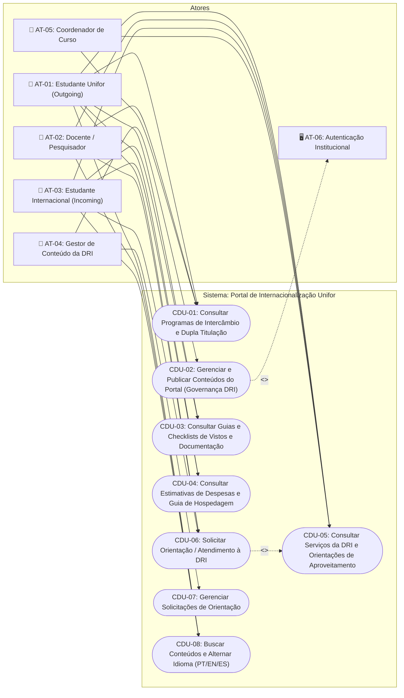
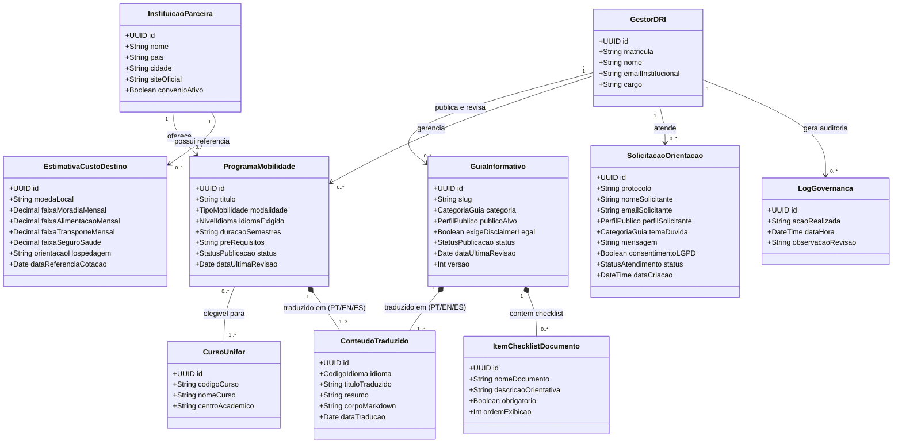
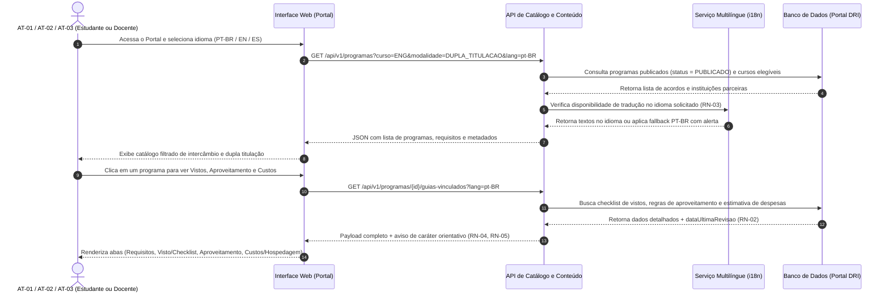
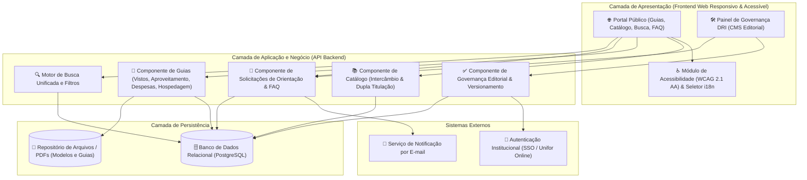
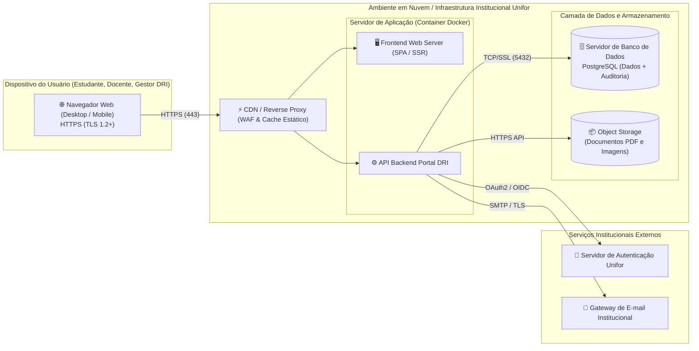

# 📐 Modelagem UML — Portal de Internacionalização (`requisitos-20262-grupo9`)

Esta pasta reúne todos os diagramas UML do **Projeto 4 — Portal de Internacionalização**, cobrindo tanto os entregáveis da **Atividade 1 (P1)** quanto todas as issues de modelagem da **Milestone M1 (`[US] Criar diagrama de casos de uso`, `[US] Criar diagrama de classes`, `[US] Criar diagrama de sequência`, Componentes e Implantação)**.

---

## 1. Diagrama de Casos de Uso

> Fonte PlantUML também disponível em: [diagrama-casos-de-uso.puml](diagrama-casos-de-uso.puml)

---

## 2. Diagrama de Classes de Domínio

> Arquivo fonte: [diagrama-classes.mmd](diagrama-classes.mmd)

---

## 3. Diagrama de Sequência — Fluxo Principal (CDU-01: Consulta de Programas e Guias)

> Arquivo fonte: [diagrama-sequencia.mmd](diagrama-sequencia.mmd)

---

## 4. Diagrama de Componentes

> Arquivo fonte: [diagrama-componentes.mmd](diagrama-componentes.mmd)

---

## 5. Diagrama de Implantação

> Arquivo fonte: [diagrama-implantacao.mmd](diagrama-implantacao.mmd)

